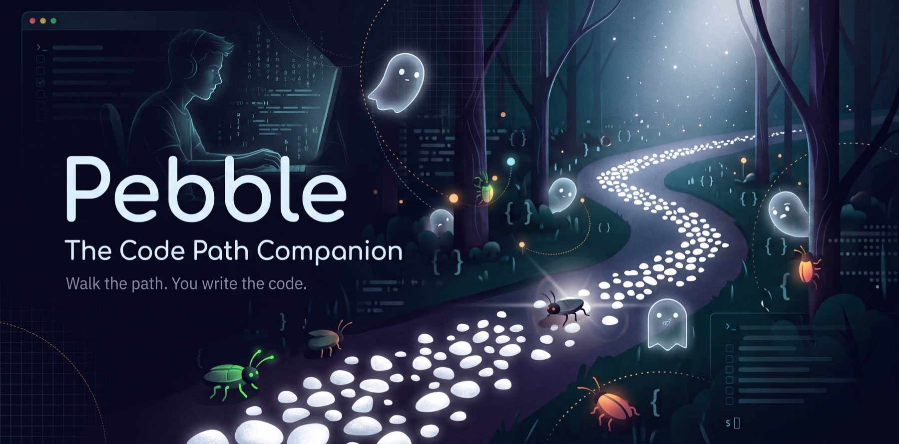
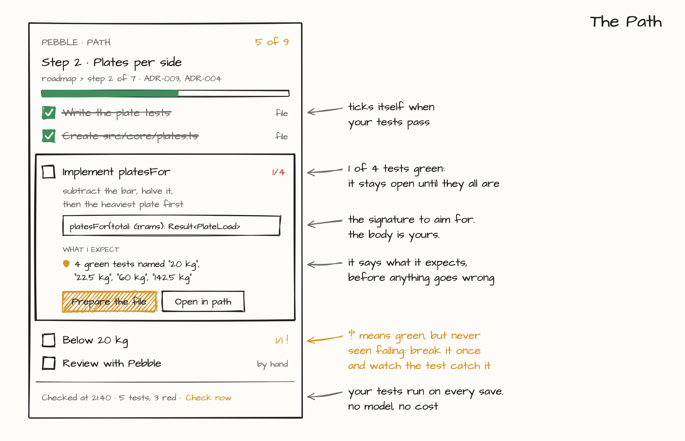
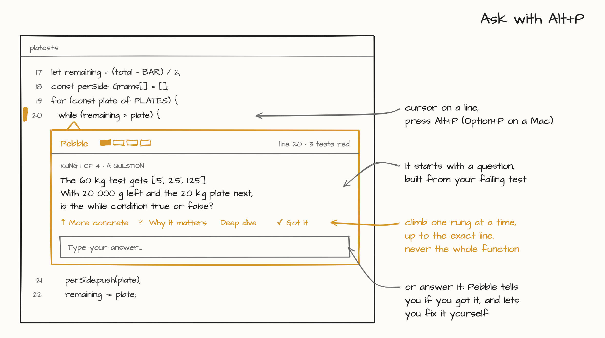
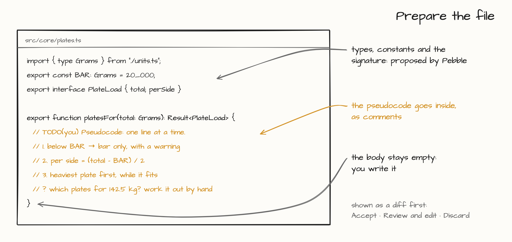

<p align="center">
  
</p>

<p align="center">
  <a href="LICENSE"></a>
  
  
  
  
  
  <a href="https://github.com/LordKenzo/pebble-code-companion/commits/main"></a>
</p>

#  Pebble :: The Code Path Companion

**Walk the path. You write the code.**

Pebble is a pair engineer that lives in your editor. It turns what you want to build into a path of small steps. It prepares each file with signatures and pseudocode, and checks your progress with your own tests and compiler. When you get stuck and ask, it helps you think instead of handing you the answer.

It never writes your project's logic for you. That part is yours, and it is how you learn.

## Why "Pebble"

In the old tale (Hop-o'-My-Thumb in English, *Pollicino* in Italian), a boy is led into the woods and drops white pebbles along the way. When night falls, the pebbles shine in the moonlight and lead him home.

Pebble does the same for a coding project:

- **The pebbles are your decisions.** Every architectural choice is written down as a short ADR in `.pebble/`, together with the architecture and the roadmap. They mark the road you have taken and bring you back when the code starts to drift.
- **The path is the roadmap.** Each step becomes a checklist of tasks small enough to finish in one sitting.
- **Pebble walks beside you, not ahead of you.** It shows the way, it does not carry you.

## Philosophy

### You write the logic
AI tools can now write whole projects. That is great when you want the result, and useless when you want the skill. Pebble draws a line in three zones:

| Zone | What it covers | What Pebble does |
|---|---|---|
| **A · Tooling** | Commands, `package.json`, `tsconfig.json`, `.gitignore`, CI | Gives it to you complete, with every line explained. Fighting config teaches nothing. |
| **B · Structure** | Folders, modules, signatures, types, contracts | Proposes something concrete: one recommended option, not a menu. |
| **C · Logic** | Function bodies, domain rules | Questions, pseudocode, an analogous example, at most the one line you got wrong. Never the body. |

### A path, not a chat
A chat waits for you to know what to ask. A path tells you where you are and what comes next. Each task says what to do, why, the signature to aim for and when it counts as done.

### Tests are where Pebble helps the most
You write the tests, and Pebble is at your side for every one of them:

- **Which cases to cover**: the edge cases first, the ones taken from your own rules ("below the bar weight", "exactly on the 12-hour limit"), each named as the behaviour it checks.
- **A first test, complete**: one finished test per task, so you see the style and the setup. The rest you write following it.
- **Where to start**: the test that will drive the design, not the easiest one.
- **What is missing**: when you review a test file, Pebble points out the case nobody thought of.
- **Why it failed**: when a test is red, the `⌥P` balloon starts from the failing output.

### Your tests tick the boxes
A task closes itself when your tests and your compiler say so: no manual bookkeeping, and no pretending. If a test breaks later, the task opens again.

A ticked box means *your tests pass*, not *your code is correct*. A test that checks nothing would pass too. So Pebble remembers whether it has ever seen each test fail. If a test went green without ever being red, the task still ticks, but Pebble tells you so and suggests breaking the code for a moment to watch the test catch it.

### The path grows with you
Code changes the plan: you find a case nobody thought of, rename a file, change your mind, make a new decision. So Pebble lights the path one step at a time. Only the current step is broken into tasks; when it is done, Pebble plans the next one from the code as it is now. Discoveries along the way, like a test the balloon suggested, become tasks with one click. Pebble never rewrites the path behind your back: every change is a proposal you accept or discard. The tasks you finished stay in the file. They are the pebbles behind you, the story of how you got here.

### Quiet until called
No pop-ups while you type, and no Clippy. Press `⌥P` on a line and a balloon opens right there, under your code. Close it and Pebble goes back to silence.

### Questions before answers
Help comes as a ladder. You climb one rung at a time, only as far as you need:

1. **A question**: "The 60 kg test gets [15, 2.5, 1.25]. Why does the loop skip the 20?"
2. **A precise direction**: what to look at, using your own names.
3. **An analogous example**: the same idea in a different setting.
4. **The exact line**: at most three lines, then a test that would have caught it.

### It teaches
Behind most bugs there is a concept: an off-by-one error, a greedy algorithm, a missing transaction. **Deep dive** explains it, suggests a habit and leaves you a small exercise. The **notebook** collects the concepts you meet along the way, marked as *new*, *got it* or *to review*.

### Anchored to your project, honest about the rest
Every note says where it comes from: one of your ADRs, your `bootstrap.md`, or `best practice` when it is simply how the ecosystem works. Project decisions come first. Best practices are always flagged, never passed off as your rules.

## Who it's for

- **People learning to program**, who want a project of their own and not a tutorial, with someone at their side who explains the why.
- **Junior developers** starting their first real projects, who want to learn architecture, tests and decisions while they build.
- **Anyone picking up a new language or stack**, who knows how to program but not yet how things are done there.

Pebble is not built for speed. If you already know what to write and want it written fast, a coding agent is the better tool, and Pebble will stay out of your way. You can delete the path, ignore the balloon, and keep only the reviews.

## How it works

1. **Write a `bootstrap.md`**: what you want to build, your constraints, what you do not know yet.
2. **`Pebble: init`** reads it and proposes decisions (ADRs), an architecture, a folder structure and a roadmap. They are saved in `.pebble/` and you can edit them: Pebble respects what is written there.
3. **Follow the path.** The current step becomes a checklist in the side panel.
4. **Prepare the file.** Pebble writes the imports, the types and the signature. The pseudocode goes inside the function as comments, and the body stays empty for you:

   ```ts
   export function platesFor(total: Grams): Result<PlateLoad> {
     // TODO(you) Pseudocode: turn it into code, one line at a time.
     // 1. below the bar weight → bar only, with a warning (ADR-004)
     // 2. per side = (total − BAR) / 2, in whole grams (ADR-003)
     // 3. for each plate, heaviest first:
     //      while it fits in what is left → add it, subtract its weight
     // 4. at the end nothing must be left
     // ? Before you start: which plates do you expect for 142.5 kg? Work it out by hand.
   }
   ```

5. **Write it, run your tests.** Tasks tick themselves as tests turn green.
6. **Stuck? `⌥P`.** Climb the ladder as far as you need.
7. **Review.** When a file is done, ask Pebble to review it against your decisions and best practices.

## A look at it

Sketches of the experience, not screenshots: the extension is a moving prototype, and these show the idea it is heading for.

**The Path.** The current step as a checklist. Each task says what to do, the signature to aim for and what Pebble expects, and ticks itself when your tests and the compiler agree.

<p align="center"></p>

**Ask with Alt+P.** A balloon right under your line. It starts with a question built from your failing test, and climbs one rung at a time only when you ask.

<p align="center"></p>

**Prepare the file.** Imports, types, the signature and the pseudocode as comments. The body stays empty: that part is yours.

<p align="center"></p>

The sketches are drawn with [rough.js](https://roughjs.com) from [`assets/sketches/sketches.html`](assets/sketches/sketches.html).

## Status

Pebble is an early, working prototype, built in the open and dogfooded on itself. This repository's own `bootstrap.md` and `.pebble/` were produced by Pebble.

| | |
|---|---|
| **Works today** (extension v0.7) | `init` from `bootstrap.md`, file review as VS Code diagnostics, a side-panel conversation, `next` and `tests` commands, the three zones enforced by both the prompt and a filter, experience levels from entry to senior, cost tracking. **New:** the Path panel, styled like the mockup. It reads `.pebble/percorso.md`, and tasks tick themselves when you save: Pebble runs your tests (any runner with TAP output), reads the compiler errors VS Code already has, and warns you when a test has never been seen failing. **Also new:** the `⌥P` balloon on the current line: it starts with a question built from your failing tests, climbs the help ladder on request, answers your replies, and offers *why it matters* and a deep dive. When a step is done, **Prepare step N** plans the next one from your code as it is now, and shows it as a diff to accept or discard. **Prepare the file** writes the skeleton of a missing file: imports, types, signatures and pseudocode as comments, with empty bodies; for a test file, one complete example test and the other cases as `test.todo`. Providers: Anthropic, OpenAI or any OpenAI-compatible local server such as Ollama. |
| **In design** | The notebook, and tracking drift when files or tests are renamed. See the interactive mockup in [`mockup/on-demand.html`](mockup/on-demand.html) and the plan in [`docs/piano-pair-engineer.md`](docs/piano-pair-engineer.md). |

Heads-up: the prompts, ADRs, evals and internal docs are in Italian for now, because that is the language the project is being built in. English versions will follow.

## Repository layout

| Path | What is inside |
|---|---|
| `bootstrap.md` | Pebble's own bootstrap |
| `.pebble/` | Pebble's own architecture, ADRs and roadmap |
| `prompts/mentor.md` | The mentor system prompt: the real product |
| `evals/` | Prompt evaluation cases, fixtures, the runner and the report |
| `extension/` | The VS Code extension (TypeScript) |
| `mockup/` | Interactive mockups: the original live session and the on-demand path |
| `docs/` | Landscape, naming notes and the pair engineer plan |

## Try the extension

You need Node.js 22.18 or newer and VS Code 1.100 or newer.

```sh
cd extension
npm install
npm test
npm run package
code --install-extension pebble-0.7.6.vsix --force
```

Then run **Pebble: Set API key** from the command palette, or choose a local model in **Pebble: Settings**. Your code is sent to the provider you choose. With a local model it never leaves your machine.

Run the prompt evals (they use Claude Code in headless mode):

```sh
python3 evals/run.py           # all cases
python3 evals/run.py 11 12     # selected cases
```

## License

[MIT](LICENSE)
